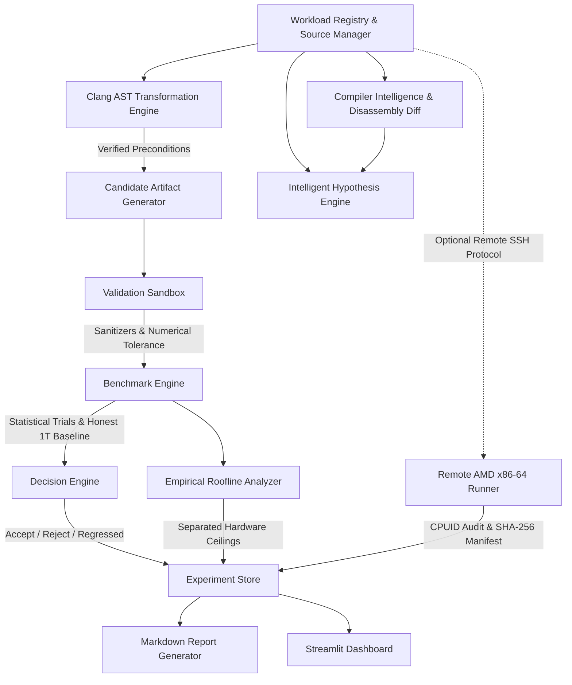

# Axiom 2.2 System Architecture Specification
## Advanced Architecture Intelligence

## 1. Architectural Philosophy

Axiom 2.2 is structured around **first-principles performance engineering**, **hardware-software co-design**, and **reproducible benchmarking validity**. Software performance optimization cannot rely on unverified heuristics, theoretical claims, or ungrounded synthetic assertions. Every accepted candidate must be proven correct and empirically measured under controlled conditions.

---

## 2. Core Subsystems

### A. Constrained Clang AST Transformation Engine (`axiom/ast_transform.py`)
- Employs Clang's official JSON AST dump (`clang++ -Xclang -ast-dump=json -fsyntax-only`) to inspect C++ loop nests and AST syntax trees.
- Evaluates formal safety preconditions before permitting transformation:
  1. **Canonical Loop Bounds:** Verifies induction variable initialized to 0, tested via `< upper_bound`, incremented via `++`.
  2. **Type Safety:** Verifies induction variables are integral primitives and buffer arrays are floating-point scalars.
  3. **Absence of Side Effects:** Rejects loops containing `CallExpr`, `CXXThrowExpr`, `GotoStmt`, `ReturnStmt`, or `BreakStmt`.
  4. **Aliasing & Mutability:** Ensures input pointers are `const`-qualified with isolated destination pointers.
- Generates candidate artifacts (e.g. `cpp/workloads/generated/matmul_ast_candidate.cpp`) with full provenance headers.
- Independently compiles candidate and executes numerical tolerance verifier ($\epsilon_{\text{rel}} < 10^{-4}$) prior to benchmarking.

### B. x86-64 Architecture Support & AVX-512 Kernel (`matmul_avx512.cpp`, `axiom_cpu_features.hpp`)
- Implements hand-tuned AVX-512 matrix multiplication kernel using 512-bit ZMM registers processing 16 single-precision floats per vector with `_mm512_loadu_ps`, `_mm512_fmadd_ps`, `_mm512_storeu_ps`, and `_mm512_set1_ps`.
- Implements 32-float unrolling and complete non-power-of-two tail loop handling for bounds safety.
- Features runtime CPU feature detection (`detect_cpu_features()`):
  - On x86-64: queries CPUID (leaf 7, subleaf 0) for `AVX512F`, `AVX512CD`, `AVX512BW`, `AVX512DQ`, `AVX2`.
  - On ARM64 (Apple M4): detects ARM64 architecture, sets `has_neon=True`, `has_avx512f=False`.
- `matmul_avx512_dispatched` safely gates execution at runtime, executing native ZMM instructions only when CPU support is verified and falling back safely to portable code on unsupported hosts.
- Verified via Clang cross-compilation check targeting `x86_64-apple-macos -mavx512f`.

### C. Optional Remote AMD Execution Adapter (`axiom/remote.py`)
- Provides an isolated SSH runner for executing workloads on genuine remote AMD x86-64 hardware.
- Security and integrity:
  - Zero hardcoded credentials: uses standard SSH agent/keys or environment variables (`AXIOM_REMOTE_HOST`, `AXIOM_REMOTE_USER`).
  - Pre-execution probe audits remote CPU architecture (`x86_64`), CPU vendor (`AuthenticAMD`), model, and flags.
  - Generates versioned experiment specifications hashed with SHA-256 manifests.
  - Enforces execution timeouts and preserves logs and exit codes.
- Local Mock Transport (`MockAMDTransport`): enables offline protocol and integrity verification on Apple M4 without remote hardware, strictly tagging mock results with `is_mock=True`.

### D. Empirical Roofline Analysis Module (`axiom/roofline.py`)
- First-principles calculation of operational intensity ($I = \text{FLOP/byte}$) across workloads:
  - GEMM F32 compulsory intensity: $I = \frac{2N^3}{12N^2} = \frac{N}{6} \text{ FLOP/byte}$.
  - GEMM naive unblocked strided access: $I \approx 0.5 \text{ FLOP/byte}$ (bandwidth constrained).
  - Conv2D and Memory Working-Set sweeps.
- Strict hardware ceiling separation:
  - **Empirical Measured Ceilings:** measured peak compute throughput and sequential DRAM bandwidth on host.
  - **Theoretical Ceilings:** hardware specification limits (e.g. 70.4 GFLOP/s single-core NEON, 120 GB/s DRAM bandwidth) with documented source and assumptions.
- Ridge point calculation: $I_{\text{ridge}} = \frac{\text{Peak Compute}}{\text{Peak Bandwidth}}$.
- Classifies execution points into `memory_bound` or `compute_bound` regimes.
- Emits ASCII charts for CLI inspection and JSON artifacts for dashboard visualization.

### E. Benchmark Validity & Statistical Decision Engine (`axiom/benchmark.py`, `axiom/decision.py`)
- Computes comprehensive statistics: Median, IQR, Mean, StdDev, $p_{50}, p_{90}, p_{95}, p_{99}$, 95% Confidence Intervals, Welch's t-test ($p < 0.01$).
- **Honest Parallel Scaling:** Computes `speedup_vs_best_single` alongside baseline speedup, distinguishing 33x vs naive scalar from 2.6x genuine parallel scaling vs 1-core NEON.
- Rejection criteria:
  - `REJECTED_CORRECTNESS`: output exceeds numerical error tolerance.
  - `REJECTED_REGRESSION`: statistically significant performance regression ($p < 0.01$).
  - `INCONCLUSIVE_NOISY`: coefficient of variation exceeds noise threshold ($CV > 15\%$).
  - `RECOMMENDED`: statistically verified speedup with low variability.
